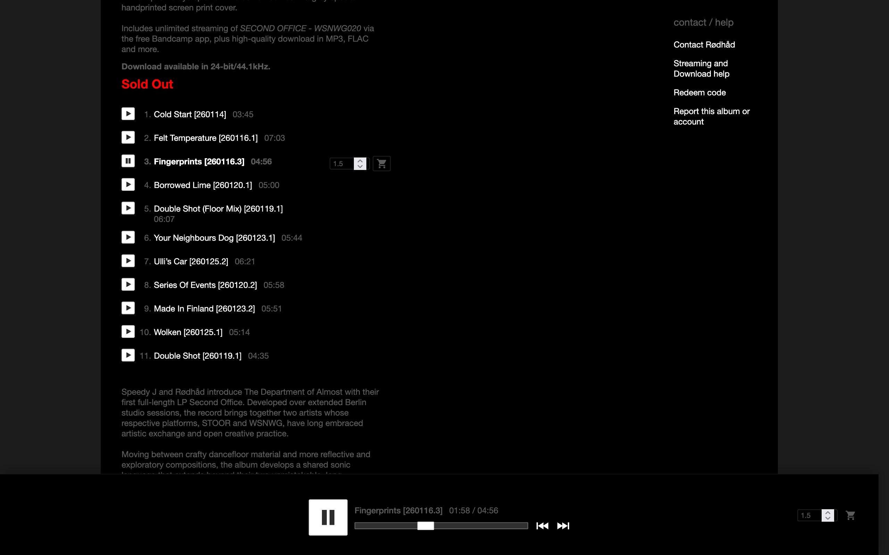

# BU for Bandcamp

Enhance your Bandcamp experience.

## Features
- Player stays pinned at the bottom, so it never scrolls out of view.
- Click anywhere on the bar to jump to that point in the track.
- Songs play one after another without scrolling back to the top.
- Previous and next buttons to move between tracks.
- Buy a track in one click: a price field and an "add to cart" button. You can set the price with no page navigation.

## Install

**From a release:**
1. Download `chrome.zip` (Chrome/Edge/Brave) or `firefox.zip` from the [latest release](../../releases/latest) and unzip it.
2. Chrome/Edge: open `chrome://extensions`, enable **Developer mode**, click **Load unpacked**, select the folder.
3. Firefox: open `about:debugging` → **This Firefox** → **Load Temporary Add-on**, pick `manifest.json` in the unzipped folder.

**From source:** `yarn install && yarn build`, then load `dist/chrome` unpacked.

## Build

- `yarn build` — builds `dist/chrome` and `dist/firefox`.
- `yarn package` — adds `dist/chrome.zip` / `dist/firefox.zip` for store upload.
- `yarn typecheck` — type-check only.
- `yarn test` - runs the unit tests in `tests/`.
- `yarn lint` - lints `dist/firefox` with web-ext (run `yarn build` first).
- `yarn icons` - renders the PNG icons and store images from `assets/icons/*.svg`.

Sources are in `src/` (`content.ts` isolated world, which starts `player-bar.ts` and `buy-links.ts`; `bandcamp.ts` holds everything that depends on Bandcamp's page; `bridge.ts` main world for the cart, `options.ts` settings). Release versioning lives in `scripts/next-version.mjs` and `scripts/set-version.mjs`. The shared manifest is `manifest.base.json`; per-browser fields are added by `build.mjs`.

Store builds are reproducible: with Node 22 and Yarn 1.22 on macOS or Linux, running `yarn install --frozen-lockfile && yarn package` in the `source.zip` attached to each release produces the same `dist/firefox.zip` and `dist/chrome.zip` that were submitted.

## Release

Label a PR `release:patch` / `release:minor` / `release:major` and merge it. `auto-release.yml` pushes a tag with the next version, worked out from the last tag (`package.json` isn't bumped); `release.yml` builds the zips (plus a `source.zip` for Firefox review) and publishes to the Chrome, Firefox, and Edge stores. Each store is published to only once its repo secret exists: `SUBMIT_KEYS_CHROME`, `SUBMIT_KEYS_FIREFOX` or `SUBMIT_KEYS_EDGE`, each holding that store's [bpp](https://github.com/PlasmoHQ/bpp) keys JSON (for example `{"firefox": {...}}`).

## License

BU for Bandcamp - Enhance your experience.  
Copyright (C) 2026 Matias Berrutti

This program is free software: you can redistribute it and/or modify it under the terms of the GNU General Public License as published by the Free Software Foundation, either version 3 of the License, or (at your option) any later version.

See the [LICENSE](LICENSE) file for the full terms.
